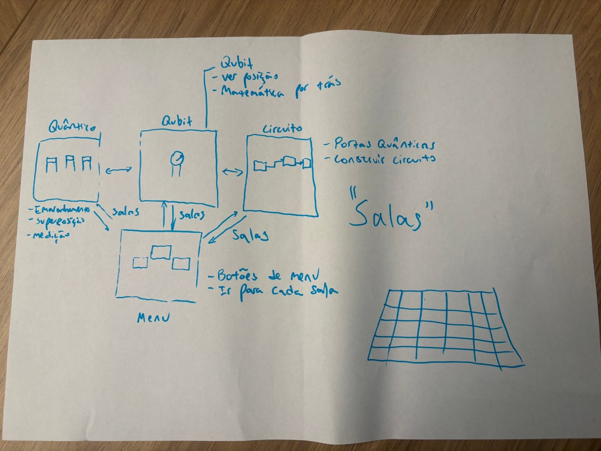

# Mapa de Interação — Qubit Lab VR

Planta das salas, percurso do corpo e elementos imersivos de cada parada, organizados a partir dos conceitos de corpo, percepção e narrativa espacial.

## 1. Planta das salas

A experiência é organizada em **salas**. O **Menu** é o ponto de partida e liga as três salas de conteúdo; Quântico, Qubit e Circuito formam uma sequência, do conceito à construção.

| Sala | O que acontece | Conteúdo |
|---|---|---|
| **Menu** | Escolher a sala | Botões de menu; ir para cada sala |
| **Quântico** | Observar fenômenos | Superposição, medição e emaranhamento |
| **Qubit** | Manipular um qubit | Ver as posições do estado na esfera de Bloch e a matemática por trás |
| **Circuito** | Construir | Portas quânticas; construir um circuito |

O chão quadriculado de 1 m, presente em todas as salas, é a **régua** do espaço: mostra escala e distância sem precisar de instrução.

## 2. Percurso do corpo

| Etapa | Onde o corpo está | O que vê primeiro | Como segue |
|---|---|---|---|
| **Início** | Em pé no Menu, de frente para os botões | O título "QUBIT LAB VR" e os três botões em arco, na altura dos olhos | Aponta o controle para uma sala e aperta o gatilho |
| **1. Quântico** | Na borda de uma plataforma de 40 × 40 m | As três estações em arco, cada uma com título numerado | Aponta para o chão e teleporta até cada estação |
| **2. Qubit** | Diante do pilar central | A esfera de Bloch na altura do olhar, com o painel de estado ao lado | Aponta para a esfera e gira o qubit segurando o gatilho |
| **3. Circuito** | Diante da bancada (em desenvolvimento) | A bancada com os fios dos qubits | Monta conexões e encaixa portas |
| **Saída** | No chão de cada sala | Os botões **MENU** e **SAIR DO VR** | Volta ao Menu ou sai da experiência |

**Ordem sugerida:** Quântico → Qubit → Circuito. A ordem das salas é a ordem do aprendizado: primeiro observar o fenômeno, depois entender o estado de um qubit e, por fim, combinar qubits em circuitos.

## 3. Marcos e linhas de visada

| Sala | Marco | Como orienta sem instruir |
|---|---|---|
| Menu | Título neon e botões em arco | O arco volta todos os botões para o jogador; o título acima marca a frente |
| Quântico | Títulos numerados das estações (1, 2, 3) | Visíveis da entrada, indicam a ordem de visita |
| Qubit | Pilar com a esfera no centro | É o único objeto alto da sala e concentra a linha de visada |
| Circuito | Bancada | Ponto de trabalho único, de frente para o jogador ao chegar |
| Todas | Bordas neon da plataforma | Delimitam o espaço e indicam até onde o corpo pode ir |

## 4. Decisões sobre o corpo

**Primeira vista:** ao entrar em cada sala, o jogador é colocado de frente para o conteúdo principal; nenhuma sala começa de costas para o que importa.

**Passagem controlada:** as salas só se abrem pelo Menu. O jogador escolhe a sala, mas cada sala libera seu conteúdo por etapas (por exemplo, na Medição, primeiro medir, depois repetir e só então ler o histograma).

**Régua do corpo**

| Pergunta | Resposta no projeto |
|---|---|
| O que a pessoa precisa segurar? | Os dois controles do Quest: o direito para mirar e confirmar, o esquerdo para andar com o analógico |
| Quanto ela pode girar, e com que conforto? | 360° em pé; sentada, o conteúdo principal fica num arco à frente para evitar giros completos |
| O que ela precisa ver enquanto se move? | O anel de destino no chão; o teleporte é instantâneo para evitar enjoo |
| Quanto tempo ela aguenta nessa posição? | Cada estação foi pensada para poucos minutos de braço levantado; o tempo real deve ser medido nos próximos testes |

## 5. Interações por sala

Mirar é apontar o laser do controle; confirmar é apertar o gatilho. Cada confirmação gera uma vibração curta.

| Sala | Entrada | Ação | Resposta do ambiente |
|---|---|---|---|
| Menu | Laser + gatilho no botão | Escolher a sala | O botão acende ao ser mirado; o controle vibra e a sala muda |
| Quântico | Laser + gatilho nos botões da estação | Mudar estado, medir, repetir, preparar, explicar | Lobos mudam de tamanho, a seta para de girar ao medir, o histograma cresce, o painel de explicação abre |
| Qubit | Laser na esfera + segurar gatilho | Girar o vetor de estado | θ, φ, amplitudes e probabilidades mudam em tempo real; o desafio confirma o estado encontrado |
| Circuito | Laser + gatilho | Montar conexões e encaixar portas (em desenvolvimento) | O estado atravessa as portas até o resultado |
| Todas | Laser no chão + gatilho | Teleportar | Anel ciano marca o destino |
| Todas | Analógico esquerdo | Andar | Deslocamento contínuo pela plataforma |

## 6. Elementos imersivos por parada

Para cada elemento, a relação com a técnica (Ihde e Verbeek) e a ilusão que ele sustenta (Slater): **lugar** (a sensação de estar ali) ou **plausibilidade** (a sensação de que aquilo está acontecendo).

| Parada | Elemento | Tipo | Relação | Ilusão |
|---|---|---|---|---|
| Todas | Céu noturno, estrelas, neblina e grade | Imagem e luz | Fundo: contexto que não é experimentado diretamente | Lugar |
| Todas | Controle com laser e vibração | Objeto e resposta | Incorporação: o controle se junta ao corpo e recua da atenção | Lugar |
| Menu | Botões que acendem ao serem mirados | Resposta do ambiente | Imersão: o ambiente detecta o gesto e dá retorno | Plausibilidade |
| Quântico | Elétrons com seta girando e lobos de probabilidade | Imagem e objeto | Hermenêutica: a representação pede leitura | Plausibilidade |
| Quântico | Painel de explicação | Texto na cena | Aumento: uma camada de leitura sobre o mundo | Plausibilidade |
| Qubit | Esfera de Bloch que gira com o controle | Objeto e resposta | Incorporação, durante o giro | Plausibilidade |
| Qubit | Painel de estado e desafio | Texto e resposta | Alteridade: o painel "pede" um estado ao jogador | Plausibilidade |
| Circuito | Bancada e portas encaixáveis | Objeto (em desenvolvimento) | Incorporação, ao encaixar as peças | Lugar e plausibilidade |
| Todas | Som ambiente elétrico | Som (planejado) | Fundo | Lugar |

## 7. Coerência do mundo

- **World building (o que existe):** luz e estrutura. O que é conceito quântico é luz (linhas, anéis, esferas translúcidas); o que é suporte é sólido e escuro (plataformas, pilares, bancada). Não existem elementos orgânicos nem objetos do cotidiano.
- **Direção de arte (como tudo se parece):** tudo é feito da mesma matéria visual: ciano e magenta emissivos sobre preto azulado, com geometria limpa e grade de 1 m (ver [`moodboard.md`](moodboard.md)).
- **Juntas:** cada sala tem a mesma plataforma, as mesmas bordas, os mesmos botões no chão e o mesmo céu. A mudança de sala muda o conteúdo, não as regras do mundo.

## 8. O que mudou na ficha

1. O espaço deixou de ser um mapa único e passou a ser organizado em **salas**, para que a ordem do percurso seja a ordem do aprendizado.
2. A interação principal passou a ser o **controle**: nos testes, a pinça misturava clicar e teleportar e o olhar com tempo era lento.
3. O **corpo** passou a ser pensado como quem percebe agindo: o controle incorporado deixa a atenção livre para os fenômenos quânticos.
