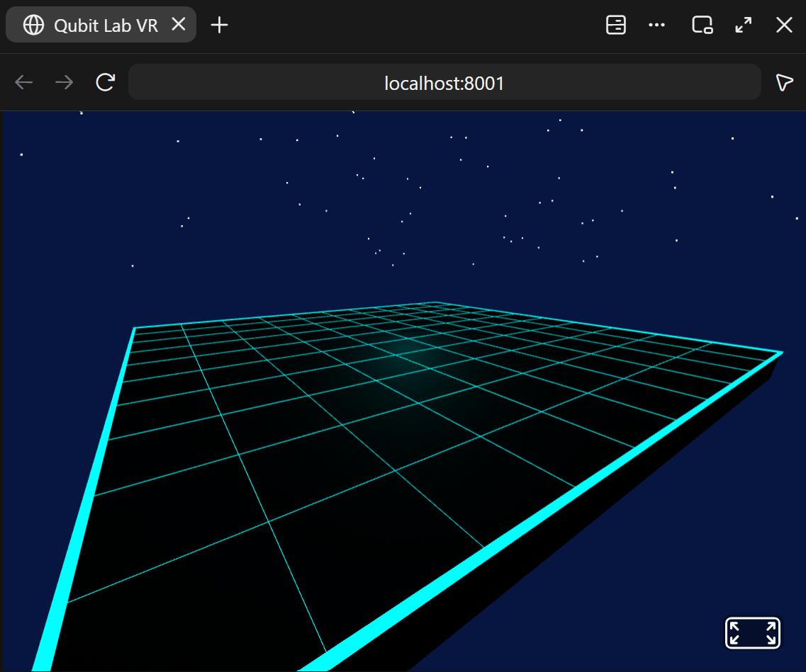
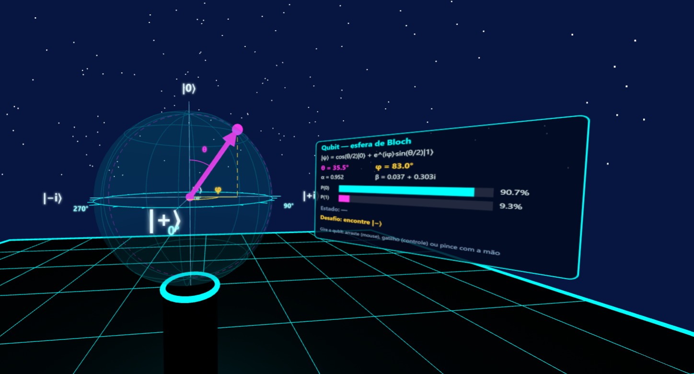

# Moodboard — Qubit Lab VR

Atmosfera da experiência: um laboratório quântico **noturno, elétrico e tecnológico**, em que o usuário está sobre plataformas neon flutuando no céu e os conceitos quânticos aparecem como luz.

## Referências do próprio projeto

| Plataforma neon (versão 1) | Qubit na esfera de Bloch (versão 2) |
|---|---|
|  |  |

## Palavras-chave

**Noturno · elétrico · neon · flutuante · translúcido · preciso · calmo · curioso**

- O ambiente é calmo e escuro; a energia vem dos objetos que brilham.
- O que é conceito quântico é luz (linhas, anéis, esferas translúcidas); o que é estrutura é sólido e escuro (plataformas, pilares).

## Paleta

| Função | Cor | Hex |
|---|---|---|
| Céu noturno | Azul-marinho | `#071640` |
| Fundo profundo / neblina | Azul quase preto | `#020818` |
| Plataformas e pilares | Preto azulado | `#030712` |
| Grade, bordas e destaques | Ciano neon | `#00FFFF` / `#2EF2F2` |
| Vetor de estado, ações e alertas | Magenta neon | `#FF3DF2` / `#FF6BF2` |
| Ângulo φ e avisos | Amarelo | `#FFD23D` |
| Texto | Branco azulado | `#E6FBFF` |

## Luz e materiais

- **Luz:** ambiente fraca e azulada, com um brilho ciano saindo do centro de cada plataforma; neblina exponencial dando profundidade ao horizonte.
- **Materiais:** emissivos para tudo que representa informação; translúcidos para as esferas (o qubit e a nuvem dos elétrons); foscos e escuros para a estrutura.
- **Estrelas:** pontos brancos fixos no hemisfério superior, fora da neblina.

## Forma

- Geometria limpa e minimalista: grades quadriculadas de 1 m, anéis, cilindros e esferas.
- Assets modelados apenas para objetos físicos e manipuláveis (ver [`assets.md`](assets.md)).
- Painéis com bordas arredondadas, fundo escuro translúcido e texto em ciano e branco.

## Movimento e som

- **Movimento:** pulsos lentos (o feixe entre os elétrons, o spin girando), sem piscar rápido.
- **Som:** zumbido elétrico ambiente baixo e efeitos curtos ao confirmar, medir e acertar.
