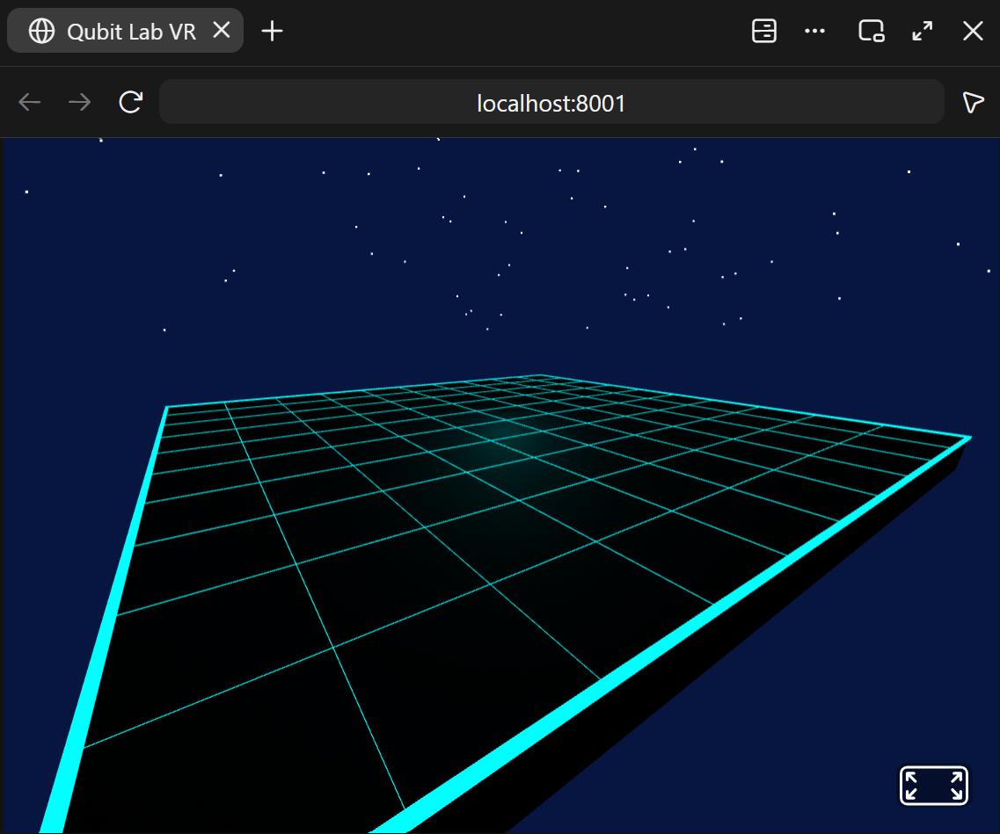
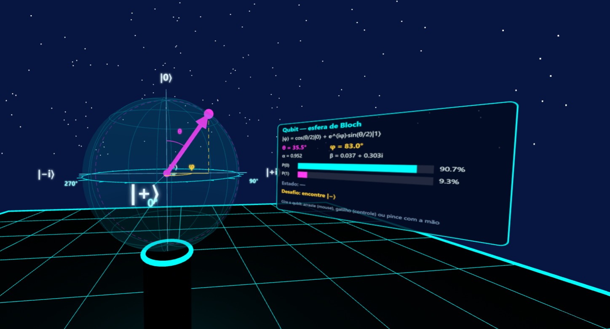
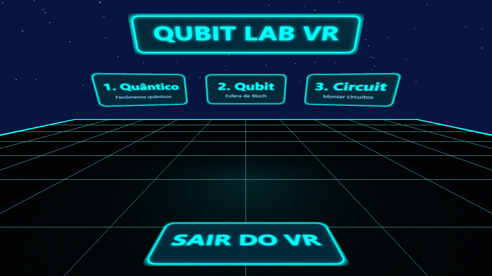

# Projeto: Qubit Lab VR

## Integrante:
- Rodrigo Hu Tchie Lee

# Projeto · Computação Quântica – Experiência Imersiva em Realidade Virtual

## Sumário

1. [Introdução](#1-introdução)
2. [Visão Geral da Solução](#2-visão-geral-da-solução)
3. [Ficha Técnica da Experiência](#3-ficha-técnica-da-experiência)
4. [Arquitetura e Tecnologias](#4-arquitetura-e-tecnologias)
5. [Desenvolvimento por Versões](#5-desenvolvimento-por-versões)
6. [Dados Captados do Usuário](#6-dados-captados-do-usuário)
7. [Próximos Passos](#7-próximos-passos)
8. [Referências](#8-referências)

# 1. Introdução

## 1.1 Termos e Abreviações

| Termo | Significado |
|---|---|
| **VR** | Realidade virtual (*Virtual Reality*) |
| **WebXR** | API do navegador para experiências de realidade virtual e aumentada |
| **A-Frame** | Framework web para cenas 3D/VR, construído sobre o three.js |
| **Qubit** | Unidade básica de informação quântica; pode estar em superposição de \|0⟩ e \|1⟩ |
| **Esfera de Bloch** | Representação geométrica do estado de um qubit como um ponto na superfície de uma esfera |
| **θ, φ** | Ângulos que definem o estado do qubit na esfera de Bloch: θ a partir de \|0⟩ e φ no equador |
| **Laser do controle** | Raio que sai do controle do Quest e indica o que está sendo mirado; o gatilho confirma |
| **Imersão × presença** | Imersão é o que o sistema oferece aos sentidos; presença é a resposta de quem está na experiência (Slater) |

## 1.2 Contexto e Motivação

Conceitos de computação quântica, como superposição, medição e emaranhamento, são abstratos e costumam ser ensinados com fórmulas, diagramas e simuladores voltados a cálculo. Esses recursos ajudam a calcular, mas nem sempre a **construir intuição**.

A realidade virtual permite colocar o estudante "dentro" do fenômeno: objetos tridimensionais, como a esfera de Bloch, viram algo que se aponta, pega e gira com o controle na mão.

## 1.3 Objetivo

Desenvolver uma experiência imersiva em VR que apoie o aprendizado de computação quântica, permitindo ao usuário **observar** fenômenos quânticos, **interagir** com qubits e **montar** circuitos quânticos em um ambiente 3D.

# 2. Visão Geral da Solução

O jogo começa em um **menu neon** e se divide em três modos, cada um em seu próprio mapa:

| Modo | Mapa | Descrição | Status |
|---|---|---|---|
| 1 | **Quântico** | Estações de superposição, medição e emaranhamento, com explicação em cada uma | Funcional |
| 2 | **Qubit** | Rotacionar e interagir com um qubit na esfera de Bloch para encontrar estados | Funcional |
| 3 | **Circuit** | Montar circuitos quânticos com portas H, X, Y, Z e CNOT | Em desenvolvimento |

Cada mapa é uma **sala** com um botão **MENU** e um botão **SAIR DO VR** no chão, em ciano neon. O mapa de interação, com a planta das salas e o percurso, está em [`mapa_interacao.md`](mapa_interacao.md). A troca entre mapas acontece na mesma cena, sem tirar o usuário do modo VR.

# 3. Ficha Técnica da Experiência

A ficha técnica completa está em [`ficha_tecnica.md`](ficha_tecnica.md). Ela especifica a experiência nos eixos de imersão:

- **Domínio:** onde a experiência acontece (nível atômico, ambiente virtual-elétrico-tecnológico).
- **Sentir:** a sensação elétrica e o propósito dela.
- **Teste da tela:** por que a experiência precisa ser em VR, e não numa tela.
- **Moldura:** o que fica dentro da cena e o que fica nos painéis.
- **Corpo:** onde o usuário está e o que pode fazer.
- **Risco:** como a visualização poderia enganar, e as mitigações.

# 4. Arquitetura e Tecnologias

- **A-Frame 1.8** (WebXR sobre three.js), em JavaScript, organizado em componentes:
  - `jogo/js/ambiente.js`: céu, plataformas neon, movimentação e limites do jogador;
  - `jogo/js/qubit.js`: qubit na esfera de Bloch e painel de estado;
  - `jogo/js/fenomenos.js`: estações de superposição, medição e emaranhamento;
  - `jogo/js/menu.js`: botões neon e gerenciador de mapas;
  - `jogo/js/testes.js`: página de testes de interação (olhar, aceno, desafio da bolinha e lousa).
- **Publicação:** **GitHub Pages**, com HTTPS, atualizado automaticamente a cada merge na `main` (https://rodrigoleee.github.io/qubit-lab-vr/).
- **Servidor local:** **Caddy em Docker com HTTPS** (`docker compose up`), no padrão do exemplo 04 do template, já que o WebXR exige contexto seguro.
- **Plataforma-alvo:** Meta Quest 3 pelo navegador, com os **controles** como interação principal e fallback para desktop (mouse e teclado).
- **Versionamento:** branch `develop` para desenvolvimento e `main` para versões estáveis, com mensagens no padrão Conventional Commits.

# 5. Desenvolvimento por Versões

## 5.1 Versão 1 — Plataforma neon

Primeira versão do ambiente do jogo: o espaço base onde os modos acontecem.

- **Céu:** noite azul-escura com estrelas espalhadas no alto.
- **Plataforma:** bloco preto de 10 × 10 m, flutuando no espaço.
- **Chão:** grade quadriculada em neon azul-ciano, com borda ciano brilhante, para reforçar a sensação **elétrica e tecnológica** definida na ficha técnica.
- **Iluminação:** luz ambiente fraca de noite, um brilho ciano saindo do centro da plataforma e neblina azul ao longe.
- **Jogador:** começa em cima da plataforma. No computador, olha com o mouse e anda com WASD; no headset, usa os controles com laser ciano para apontar.

## 5.2 Versão 2 — Qubit interativo (esfera de Bloch)

Mapa **Qubit**: um qubit interativo em cima de um pilar neon, que o jogador gira para encontrar estados quânticos.

- **Esfera de Bloch:** esfera translúcida com o vetor de estado |ψ⟩ em magenta e os estados da base marcados: |0⟩, |1⟩, |+⟩, |−⟩, |+i⟩ e |−i⟩.
- **Ciclo trigonométrico:** o equador tem marcas a cada 15° e rótulos em 0°, 90°, 180° e 270°. Os arcos mostram os ângulos **θ** (a partir de |0⟩) e **φ** (no equador), e a linha tracejada projeta a ponta do vetor no plano do equador.
- **Painel de estado:** mostra a fórmula |ψ⟩ = cos(θ/2)|0⟩ + e^(iφ)·sin(θ/2)|1⟩, os valores de θ, φ, α e β e as probabilidades P(0) e P(1) em barras.
- **Desafio:** o painel pede para encontrar um estado (por exemplo, |−⟩); ao chegar perto dele, o acerto é confirmado e um novo alvo é sorteado.
- **Escala:** qubit com diâmetro de 3/5 da altura do jogador, sobre um pilar também com 3/5 da altura.
- **Interação:** girar o qubit arrastando com o mouse, com o laser e o gatilho do controle ou **pinçando com a mão** no Meta Quest 3, sem controles.
- **Movimentação:** andar com WASD, com o analógico ou **apontando para o chão** e clicando (mouse ou controle) ou pinçando (mão).

## 5.3 Versão 3 — Menu e mapas

- **Menu neon** com a mesma estética da plataforma, com os botões **1. Quântico**, **2. Qubit** e **3. Circuit**.
- **Mapas Quântico e Circuit:** plataformas de 40 × 40 m com as mesmas mecânicas de movimentação; o conteúdo dos modos está em desenvolvimento.
- **Botão MENU** no chão de cada mapa, para voltar ao menu.
- Botões acionáveis por mouse, laser do controle ou apontando e pinçando com a mão.

## 5.4 Versão 4 — Modo Quântico, testes e controle como interação principal

- **Modo Quântico:** três estações em arco (superposição, medição e emaranhamento), cada uma com botões e painel de explicação.
- **Página de testes de interação:** olhar com tempo, aceno de cabeça, controle e PC, com o desafio da bolinha e a lousa desenhada com a cabeça.
- **Testes no Meta Quest 3:** a pinça com as mãos misturava clicar e teleportar, e o olhar com tempo se mostrou lento; o controle funcionou bem em todas as salas (ver [`testes.md`](testes.md)).
- **Pivô:** o controle passou a ser a interação principal, a pinça foi removida, e cada confirmação gera uma vibração curta.
- **Botão SAIR DO VR** no chão de cada sala.
- **Publicação no GitHub Pages**, acessível de qualquer rede pelo navegador do Quest.

# 6. Dados Captados do Usuário

O detalhamento está na seção "Dados coletados do usuário" da [ficha técnica](ficha_tecnica.md). Em resumo:

- **Cabeça (headset):** posição e rotação em 6 graus de liberdade, usadas para olhar em volta, andar fisicamente e orientar os painéis.
- **Controles:** posição, rotação, gatilho e analógico, usados para apontar, clicar, teleportar, girar o qubit e andar.
- Os dados são usados **só em tempo real**, no navegador; nada é gravado nem enviado.

# 7. Próximos Passos

- Novas rodadas de testes com outros participantes, para confirmar o pivô para o controle.
- Conteúdo do modo **Circuit**: montar conexões, escolher portas quânticas e, como potencial, exportar o circuito.
- **Portas entre salas** vizinhas, que teleportam de uma sala para a outra e fazem dos mapas separados um único lugar contínuo.
- Estação de **interferência** no modo Quântico.
- Assets modelados no Blender para os objetos físicos (bancada e portas do Circuit).
- Som ambiente e efeitos sonoros.

# 8. Referências

- A-Frame. Documentação. Disponível em: https://aframe.io/docs/
- IBM Quantum. Qiskit. Disponível em: https://www.ibm.com/quantum/qiskit
- NIELSEN, M. A.; CHUANG, I. L. *Quantum Computation and Quantum Information*. Cambridge University Press, 2010.
- W3C. WebXR Device API. Disponível em: https://www.w3.org/TR/webxr/
- IHDE, D. *Technology and the Lifeworld: From Garden to Earth*. Indiana University Press, 1990.
- LYNCH, K. *A imagem da cidade*. Martins Fontes, 1997.
- MERLEAU-PONTY, M. *Fenomenologia da percepção*. Martins Fontes, 1999.
- SLATER, M.; WILBUR, S. A Framework for Immersive Virtual Environments (FIVE): Speculations on the Role of Presence in Virtual Environments. *Presence: Teleoperators and Virtual Environments*, v. 6, n. 6, p. 603–616, 1997.
